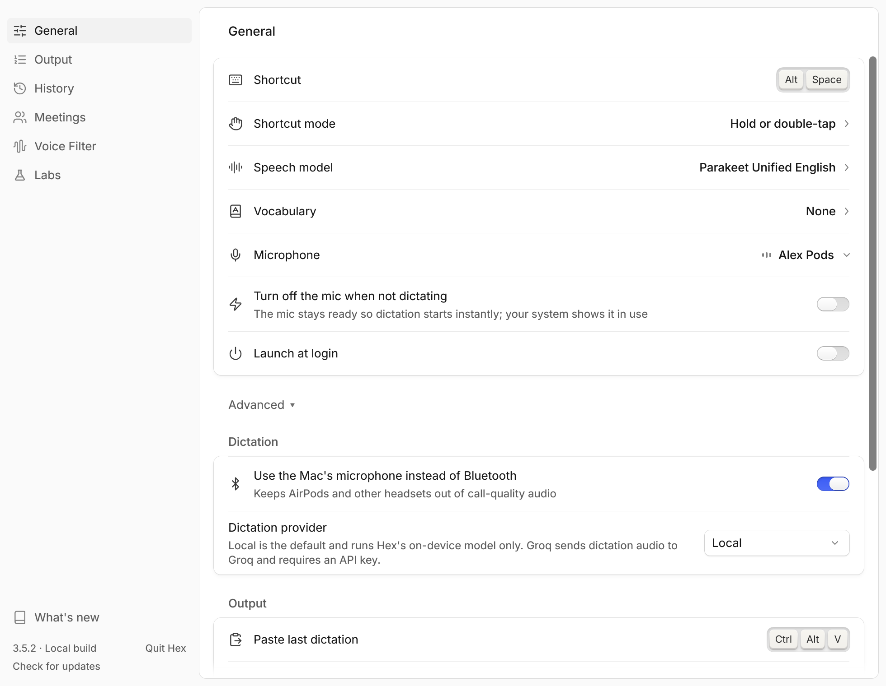

# Hex Groq Edition — unofficial fork

Hex Groq Edition is an unofficial fork of [Hex](https://github.com/anomalyco/hex).
It keeps the native local dictation experience and adds one **opt-in cloud
provider: Groq**. Local remains the default and the fallback.

Maintained at [j0ltdevv/hex-groq](https://github.com/j0ltdevv/hex-groq). This project is
not affiliated with, endorsed by, or supported by Anomaly Innovations or Groq.
Hex and Groq trademarks belong to their respective owners.

## Status

Linux x86_64 is the reference platform for this fork. macOS and Windows remain
upstream source targets, but their native behavior has not been verified here.
The fork is source-only and publishes no signed binaries or update feed.

## Screenshots




## Privacy at a glance

| Mode | What happens to dictation audio |
| --- | --- |
| **Local** (default) | Transcribed on your device. No Groq request is made, even if a key is saved. |
| **Groq** with a usable key | The complete clip is sent to Groq once. Local transcription still runs as the fallback. |
| **Groq** without a usable key, after an error, or after cancellation | The same clip is transcribed locally. A cancelled cloud result is never pasted. |
| **Meetings, the local API, and `hex transcribe`** | Local only. Groq is limited to interactive dictation. |
| **Usage records** | A bounded in-memory ring stores provider, model, outcome, sample count, and duration. It stores no key, audio, prompt, transcript, language, or cost. |
| **Updates** | Source builds are marked local and never download or install an upstream update. |

Installing or configuring the fork does not send audio anywhere. Groq is used
only after you explicitly select it. Never put a real key in an issue, screenshot,
or commit. See [`docs/GROQ.md`](docs/GROQ.md) for the full contract.

## What it does

- Hold a shortcut, speak, and paste into the focused app; Tap and Toggle modes
  are also available.
- Keep searchable dictation history, ordered output transformations, vocabulary,
  and custom speech models.
- Record and annotate the screen while you draw and talk on supported desktops.
- Run Meetings, the authenticated local API, and the TypeScript SDK on the local
  transcription path.
- Choose Local or Groq per dictation from the graphical Settings window.

## Getting started

### 1. Build from source

```sh
git clone https://github.com/j0ltdevv/hex-groq.git
cd hex
cargo build --release --bin hex
```

On Linux, `./scripts/install-linux.sh` builds and installs the same checkout into
the user-local managed layout. Platform prerequisites are listed below.

### 2. Launch the app

```sh
./target/release/hex start
```

If you installed Hex on Linux, use `hex start` instead. This opens the graphical
Hex app; you do not need to keep a terminal window open afterward.

### 3. Finish onboarding in the window

The onboarding window installs the selected local speech model and requests the
necessary desktop permissions. Local dictation works without a Groq account.

### 4. Enable Groq in Settings

1. Open **Settings → General → Advanced → Dictation**.
2. Choose **Groq** as the dictation provider.
3. Choose a Groq model.
4. Paste your API key into the masked key field.

Return to **Local** from the same control at any time. The CLI is not required
for normal GUI use.

For automation or headless setups, the key can also come from `GROQ_API_KEY` or
an owner-only `<Hex data root>/groq.key` file. Resolution order is environment →
`groq.key` → legacy saved setting. The CLI redacts `groq_api_key` and refuses to
write it.

## Build prerequisites

| Platform | Requirements | Supported source path |
| --- | --- | --- |
| **Linux x86_64 / ARM64** | Rust stable, C/C++ toolchain, CMake, ALSA/PipeWire compatibility, OpenBLAS, X11/Wayland development libraries, and a real Vulkan driver. Arch package list: [`docs/linux.md`](docs/linux.md#install-from-source). | `./scripts/install-linux.sh` or `cargo build --release --bin hex` |
| **Windows x64** | Windows 10/11, Visual Studio C++ Build Tools, CMake, stable MSVC Rust, Vulkan SDK. | `powershell -ExecutionPolicy Bypass -File .\scripts\setup-windows.ps1`, then `cargo build --release --bin hex` |
| **Windows ARM64** | Visual Studio clang-cl and Ninja; follow the ARM64 flags in [`docs/windows.md`](docs/windows.md#requirements-for-source-builds). | Same setup, then the documented ARM64 build command |
| **macOS** | macOS 15+, Xcode 26 / command-line tools, stable Rust, and the native dependencies listed in [`docs/macos.md`](docs/macos.md). | `scripts/build-app.sh`; use `HEX_RELEASE_UNSIGNED=1` for an unsigned local bundle. Upstream signing/notarization tooling is not a fork release path. |

`.cargo/config.toml` forces `HEX_LOCAL_BUILD=1`, so the app identifies itself as a
local source build and never installs an upstream update. When portability
matters, build with `-DGGML_NATIVE=OFF`; the Windows guide and Linux release
script show the supported flags.

## Optional command-line controls

Hex is a graphical app. The CLI exists for automation, Hyprland bindings,
diagnostics, local-file transcription, and SDK integration:

```sh
hex status
hex window show
hex settings list
hex logs --process -f
hex transcribe meeting.m4a
```

- `hex start` launches the app; the other controls talk to the running instance.
- `hex logs --process -f` follows Rust/native diagnostics in `process.log`.
- `hex transcribe` is always local, even when dictation uses Groq.
- On Hyprland, `hex dictation start` / `stop` can be bound in Lua when the
  GlobalShortcuts portal is unavailable.
- Full CLI contract: [`docs/cli.md`](docs/cli.md).

## Architecture

Hex is one native Rust process per user and data root:

- **Capture and platform hosts** own the microphone, shortcuts, paste, HUD, and
  OS integration.
- **`src/transcription`** owns local models, streaming, deadlines, ordering, and
  fallback.
- **`src/groq*`** is the fork-only provider: key resolution, multipart encoding,
  cancellation, retry, and secret-safe usage records.
- **`src/control`** exposes the versioned control CLI and settings registry.
- **`src/rune_ui`** is the shared graphical window on macOS, Windows, and Linux.
- **`src/local_api`** serves authenticated loopback transcription and dictation
  control; it stays local in this fork.

Fork-specific behavior is documented in [`docs/GROQ.md`](docs/GROQ.md),
[`docs/FORK.md`](docs/FORK.md), and [`docs/UPSTREAM-SYNC.md`](docs/UPSTREAM-SYNC.md).

## Known limits

| Limit | Why it remains |
| --- | --- |
| **No binaries, installers, signed releases, or update feed** | This fork has no signing/notarization credentials or release distribution pipeline. Local mode also prevents a source build from silently replacing itself with an upstream binary. |
| **macOS and Windows behavior is not verified here** | Only Linux x86_64 has physical end-to-end proof in this fork. There is no native macOS/Windows hardware and release environment behind these claims. |
| **Groq is limited to complete-clip dictation** | This is deliberate scope control. Meetings, `/dictations`, the local transcription API, and `hex transcribe` keep their local-only privacy contract. |
| **The local model still runs in parallel** | The fallback and cancellation design keeps the local path warm and available. Groq improves the final result but is not a CPU/RAM offload or a model-free installation. |
| **The usage ring is diagnostic, not billing data** | It is a bounded in-memory metadata ring with no cost field and no persisted transcripts. Groq billing APIs are not integrated. |
| **Queue pressure, cancellation timing, fallback latency, GPU behavior, and real cost are not established** | There is no production telemetry, long-running load evidence, or broad hardware matrix. Loopback checks cannot prove those real-world properties. |
| **Translations have not had a native-speaker review** | Automated coverage verifies that keys exist, not that wording is natural or culturally correct. No linguistic review has been completed yet. |
| **The TypeScript SDK needs an explicitly supplied native helper** | The transcription engine is native Rust/C++ and this fork does not package a standalone helper for SDK users. |

## Releases and upstream sync

This repository is source-only. Builds are forced into local mode so they cannot
silently replace themselves with an Anomaly binary. There is no fork release
channel yet.

The fork tracks `anomalyco/hex` and re-applies a small behavioral delta. The
current upstream baseline is `f5819f4c`. For the 2026-11-27 sync, the Rune
dependency pin intentionally remains `9d4b4636` by explicit agreement; the usual
Rune dev-head bump is deferred to a separate dependency-update round. The
intended cadence is weekly and before any future fork release. See:

- [`CHANGELOG.md`](CHANGELOG.md) for fork-specific changes;
- [`docs/FORK.md`](docs/FORK.md) for identity, scope, and support policy;
- [`docs/UPSTREAM-SYNC.md`](docs/UPSTREAM-SYNC.md) for the repeatable sync runbook.

## Contributing and support

Issues and diagnoses are welcome in this fork:
[open an issue](https://github.com/j0ltdevv/hex-groq/issues). Never include a real key,
private transcript, or unredacted log. See [`SECURITY.md`](SECURITY.md) and
[`CONTRIBUTING.md`](CONTRIBUTING.md).

## License and attribution

Upstream Hex is copyright its authors and MIT licensed; this fork carries the
same license and preserves the upstream notice. Groq is an external service and
a trademark of Groq LLC and/or its affiliates. This fork is not affiliated with
or endorsed by Groq. See [`LICENSE`](LICENSE) and
[`THIRD_PARTY_NOTICES.md`](THIRD_PARTY_NOTICES.md).
